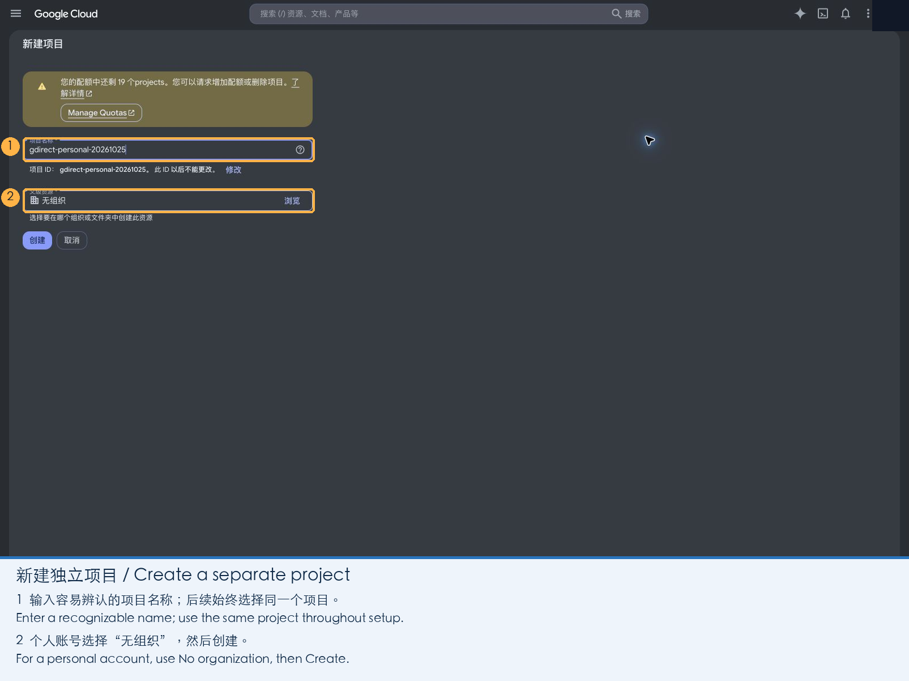
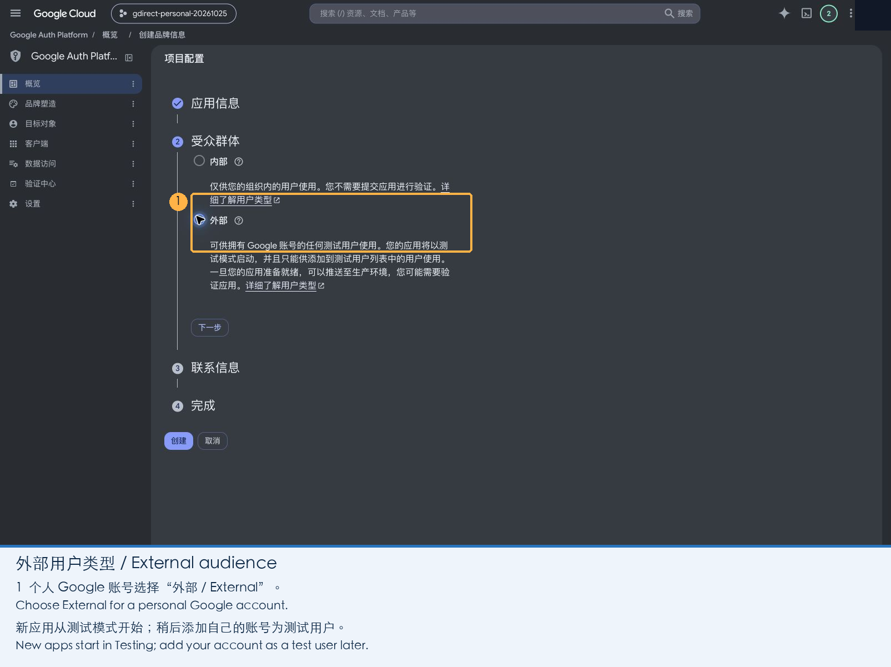
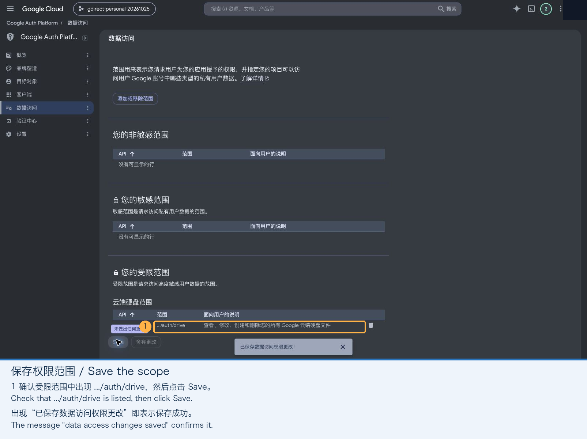

# Create a Google OAuth client

[中文](google-cloud.zh-CN.md) · [Back to Google setup](README.md)

This guide walks through the Google Cloud console, step by step, until you have a **Desktop app** OAuth client JSON for gdirect. You only do this once, and it takes about 10 minutes. Google does not charge for it.

You need a Google account and a browser. The screenshots show the console in Chinese; each one has a bilingual caption, and the numbered boxes mark what to click.

## 1. Create a project and enable the Drive API

1. Open the [Google Cloud console](https://console.cloud.google.com/). In the project selector at the top, click **New project**. Enter any name, for example `gdirect`. With a personal account, leave **Location** as **No organization**. Click **Create**, then make sure the new project is selected at the top of the page. Do every later step in this same project.

   

2. Open the [Google Drive API](https://console.cloud.google.com/apis/library/drive.googleapis.com) page. Check the project name at the top, then click **Enable**.

   

   When it is done, the page shows the service name `drive.googleapis.com` with status **Enabled**.

   

## 2. Set up the OAuth app

1. Open [Google Auth Platform](https://console.cloud.google.com/auth/overview) and click **Get started**.
2. **App information:** enter an app name, which Google shows when you sign in, and choose your own email as the support email. Click **Next**.

   

3. **Audience:** choose **External** and click **Next**. Personal accounts cannot use Internal.

   

4. **Contact information:** enter your email and click **Next**.
5. **Finish:** tick the box to accept the Google API Services User Data Policy, click **Continue**, then **Create**.

   

## 3. Add the Drive scope

1. In the left menu, open **Data Access** and click **Add or remove scopes**.
2. In the panel that opens, tick `.../auth/drive` (“See, edit, create and delete all of your Google Drive files”). If it is not in the list, paste the address below into **Manually add scopes** and click **Add to table**. Then click **Update**.

   ```text
   https://www.googleapis.com/auth/drive
   ```

   

3. Back on the Data Access page, click **Save** at the bottom. **Update** alone does not save the change.

   

gdirect needs this full Drive scope to browse your existing files, download, upload and mount Drive as a writable disk.

## 4. Create a desktop client and download its JSON

1. In the left menu, open **Clients** and click **Create client**. Set the application type to **Desktop app**, enter any name, for example `gdirect Desktop`, and click **Create**.

   

2. In the dialog that appears, click **Download JSON** **before** you close it. Once the dialog is closed, the file cannot be downloaded again. If that happens, create another client.

   

Only a **Desktop app** client works. A web client, an API key or a service-account JSON will not.

## 5. Allow your account to sign in

A new app starts in **Testing**, and only accounts on its test-user list can sign in.

1. In the left menu, open **Audience**. Under **Test users**, click **Add users**, enter the email of the Google account you will use with gdirect, and click **Save**. Check that the account now appears in the list.

   

In Testing, Google ends your sign-in after **7 days**. When that happens, run `gdirect login --reauth`.

To avoid signing in every week, you can click **Publish app** at the top of the Audience page to move the app to **In production**. For your own use, Google does not need to verify the app. If the button is grey and asks you to complete Branding, fill in the required fields on the **Branding** page first, or simply stay in Testing.

## Next

You now have the client JSON. [Sign in with gdirect](README.md#2-sign-in).
